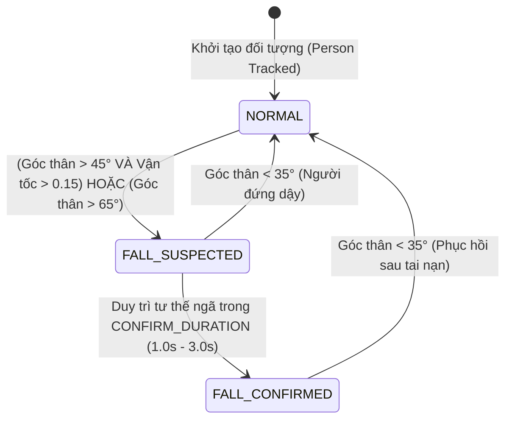

# TÀI LIỆU NGỮ CẢNH DỰ ÁN (PROJECT CONTEXT) - HỆ THỐNG NHẬN DIỆN TÉ NGÃ (FALL DETECTION AI)

---

## 1. TỔNG QUAN DỰ ÁN & ĐỀ TÀI
- **Tên đề tài đề xuất:**
  - *Hướng Kỹ thuật / Đồ án tốt nghiệp:* **Nghiên cứu và xây dựng hệ thống giám sát, cảnh báo té ngã thời gian thực tại biên (On-Device Mobile Edge AI) kết hợp kiến trúc C# .NET**
  - *Hướng Nghiên cứu Khoa học (NCKH):* **Nghiên cứu phương pháp phát hiện té ngã thời gian thực đa đối tượng trên thiết bị di động sử dụng YOLO26-Pose kết hợp mạng tích chập chuỗi thời gian (Temporal CNN)**
  - *Tên tiếng Anh:* **Real-time On-Device Multi-Person Fall Detection and Emergency Alert System Using YOLO26-Pose and Temporal CNN Integrated with .NET Architecture**
- **Mục tiêu:** Phát hiện sự cố té ngã tự động, theo thời gian thực ngay trên thiết bị di động/camera biên mà không cần truyền luồng video thô lên máy chủ (đảm bảo quyền riêng tư và tiết kiệm băng thông); loại trừ báo động giả (False Alarms); hỗ trợ giám sát đồng thời nhiều người (Multi-Person Tracking) ở nhiều góc camera và đẩy bản tin cảnh báo JSON khẩn cấp về Backend C# (.NET Core + SignalR).
- **Công nghệ cốt lõi:**
  - **Phòng huấn luyện AI (Training Lab - Python / Kaggle GPU):** Python 3.11, Ultralytics **YOLO26n-Pose** (17 COCO keypoints, kiến trúc Native NMS-Free), PyTorch, OpenCV, NumPy.
  - **Mô hình suy luận té ngã:**
    - *Nhánh chính (Deep Learning):* **Temporal CNN (`TemporalNet`)** xử lý chuỗi chuyển động khung xương cửa sổ trượt `3.0s` ở nhịp `10 Hz` (kết hợp kiểm tra tư thế hậu té ngã - Hybrid Recovery).
    - *Nhánh dự phòng / đối chiếu (Rule-based):* Góc nghiêng thân người (Body Angle), tỉ lệ khung bao (`W/H >= 0.88`), vận tốc trọng tâm và Máy trạng thái hữu hạn độc lập (Per-Person FSM).
  - **Thiết bị thực thi AI tại biên (Mobile Edge AI Client):** Ứng dụng **Android Native (Kotlin + CameraX + ONNX Runtime Mobile / TFLite FP16 GPU Delegate)** chạy độc lập 100% AI trên điện thoại **ZTE Nubia Red Magic 7** (Snapdragon 8 Gen 1, Adreno 730 GPU, quạt tản nhiệt chủ động), tích hợp bộ bám vết đa đối tượng gọn nhẹ (`Lightweight IoU + Centroid Tracker`).
  - **Backend & Tích hợp:** C# (ASP.NET Core Web API + SignalR) tiếp nhận bản tin JSON + ảnh chụp hiện trường (`Base64`), lưu cơ sở dữ liệu và phát cảnh báo tức thời lên Web/Mobile Dashboard.

---

## 2. CẤU TRÚC THƯ MỤC & CÁC MODULE CHÍNH
```text
fall-detection-ai/
├── CONTEXT.md                         # Tài liệu kiến trúc tổng thể (AI + Mobile Edge App + C# Backend)
├── REALTIME_CONTEXT.md                # Tài liệu chuyên sâu module Real-time Webcam trên PC
├── GMDCSA_TRAINING.md                 # Tài liệu quy trình huấn luyện Temporal CNN
├── GMDCSA_RESULTS.md                  # Báo cáo kết quả thực nghiệm & phân tích lỗi trên tập GMDCSA24
├── README.md                          # Hướng dẫn cài đặt và chạy nhanh trên PC
├── kaggle_train_temporal_v2.ipynb     # Notebook huấn luyện mở rộng TemporalNet đa góc camera trên Kaggle GPU
├── export_mobile_models.py            # Script xuất model YOLO26n + TemporalNet sang định dạng .onnx
├── gmdcsa_pipeline.py                 # Pipeline chuẩn bị dữ liệu, trích keypoint 10Hz và train TemporalNet
├── gmdcsa_evaluate_rules.py           # Script đối chiếu hiệu năng FSM cũ trên cùng tập Test
├── realtime_yolo_fall_detection.py    # Chương trình chạy Real-time qua Webcam/Video PC (temporal & rules)
├── yolo_fall_detection.py             # Module YOLOv8m-Pose xử lý video offline đa người
├── video_fall_detection_yolo.py       # Module YOLO11n-Pose xử lý video đa người
├── mediapipe_test.py                  # Bản thử nghiệm ban đầu bằng MediaPipe Pose (33 keypoints)
├── video_fall_detection.py            # Bản thử nghiệm video offline bằng MediaPipe Pose
├── yolo26n-pose.pt                    # Trọng số YOLO26 Nano Pose (~7.8MB - chuẩn 17 khớp COCO, NMS-Free)
├── data/
│   └── gmdcsa24_experiment/
│       └── temporal_fall.pt           # Trọng số mạng chuỗi thời gian TemporalNet (~175KB, ngưỡng 0.43)
├── tests/
│   └── test_temporal_realtime.py      # Bộ 4 unit tests kiểm chứng đồng bộ tiền xử lý offline/live
└── mobile-edge-app/                   # Dự án Android Native (Kotlin + CameraX + ONNX) cho Red Magic 7
    ├── build.gradle.kts, settings.gradle.kts
    └── app/
        ├── build.gradle.kts
        └── src/main/
            ├── AndroidManifest.xml
            ├── assets/                # Chứa yolo26n-pose.onnx, temporal_fall.onnx, model_metadata.json
            ├── java/com/falldetection/edge/
            │   ├── MainActivity.kt    # Giao diện CCTV 24/7, CameraX, đồng hồ thời gian thực
            │   ├── ai/
            │   │   ├── FallLogicEngine.kt    # FSM + Hybrid Recovery, khóa cảnh báo khi nạn nhân nằm bất động
            │   │   └── LightweightTracker.kt # Bám vết người theo IoU cực nhẹ
            │   ├── data/
            │   │   └── AppSettings.kt        # Lưu cấu hình (Tên Cam, Phòng, Địa điểm Đà Nẵng, Server URL)
            │   ├── model/
            │   │   └── DetectionResult.kt    # Data class BoundingBox, Keypoint, FallState
            │   └── network/
            │       └── AlertSender.kt        # Gửi POST /api/alerts/fall & /recovered qua OkHttp
            └── res/
                ├── layout/ (activity_main.xml, dialog_settings.xml)
                ├── values/ (styles.xml, themes.xml)
                └── drawable/ (dot_red.xml, btn_round.xml)
```

---

## 3. NGUYÊN LÝ HOẠT ĐỘNG & THUẬT TOÁN

### 3.1. So sánh 2 nhánh trích xuất đặc trưng tư thế (Pose Extraction)
| Đặc tính | Nhánh MediaPipe Pose | Nhánh YOLO Pose (YOLOv8 / YOLO11) |
| :--- | :--- | :--- |
| **Số lượng điểm mốc (Keypoints)** | 33 điểm mốc (BlazePose) | 17 điểm mốc (Chuẩn COCO) |
| **Khả năng Multi-Person** | Hạn chế (ưu tiên 1 người chính) | Mạnh mẽ (Theo dõi không giới hạn số người với `track_id`) |
| **Lọc nhiễu đối tượng** | Dễ nhầm khi có vật thể/xe cộ | Lọc tuyệt đối `classes=[0]` (chỉ nhận diện người) |
| **Hiệu năng phát hiện ở xa** | Trung bình | Rất tốt khi đặt độ phân giải `imgsz=1280` |
| **Các điểm mốc trọng yếu** | Vai (11, 12), Hông (23, 24) | Vai (5, 6), Hông (11, 12), Đầu gối (13, 14), Cổ chân (15, 16) |

### 3.2. Các chỉ số tính toán cốt lõi
1. **Góc nghiêng thân người (Body Angle):**
   - Lấy trung điểm vai ($Mid_{shoulder}$) và trung điểm hông ($Mid_{hip}$).
   - Tính góc nghiêng so với phương thẳng đứng:
     $$\text{Angle} = \arctan\left(\frac{|\Delta x|}{|\Delta y| + 10^{-6}}\right) \times \frac{180}{\pi}$$
   - Góc $\text{Angle} \approx 0^\circ - 30^\circ$: Tư thế đứng / ngồi thẳng.
   - Góc $\text{Angle} > 45^\circ - 50^\circ$: Tư thế nghiêng nhiều hoặc nằm ngang sàn.
2. **Trọng tâm cơ thể (Centroid):**
   - Tọa độ trung bình của 4 điểm: 2 vai và 2 hông trên mặt phẳng chuẩn hóa.
3. **Tốc độ dịch chuyển trọng tâm (Movement Speed):**
   - Lưu trữ lịch sử vị trí và mốc thời gian trong hàng đợi (`deque`) gồm 5 frames gần nhất.
   - Vận tốc = Tổng quãng đường Euclidean di chuyển / Tổng thời gian ($\text{khoảng cách / giây}$).
   - Giúp phân biệt giữa việc **ngã đột ngột** với việc **chủ động nằm xuống từ từ**.

---

## 4. MÁY TRẠNG THÁI (STATE MACHINE) ĐA ĐỐI TƯỢNG

Mỗi người được phát hiện sẽ gắn với một instance `PersonTracker(track_id)` sở hữu một máy trạng thái riêng biệt:



### Chi tiết các trạng thái:
1. **`NORMAL` (Bình thường - Box màu xanh lá):**
   - Đối tượng đang đứng, đi bộ, hoặc ngồi bình thường.
   - Điều kiện chuyển sang `FALL_SUSPECTED`: Khi đồng thời xảy ra **tư thế nằm** (`body_angle > ANGLE_THRESHOLD`) kèm **vận tốc biến thiên nhanh** (`speed > SPEED_THRESHOLD`), hoặc ngã với góc rất lớn (`body_angle > 65°`).
2. **`FALL_SUSPECTED` (Nghi ngờ té ngã - Box màu cam):**
   - Bắt đầu tính thời gian duy trì tư thế ngã.
   - Nếu đối tượng tự đứng dậy (`body_angle < 35°`), hủy nghi ngờ và quay về `NORMAL`.
   - Nếu đối tượng tiếp tục nằm bất động vượt quá `CONFIRM_DURATION`, chuyển sang `FALL_CONFIRMED`.
3. **`FALL_CONFIRMED` (Xác nhận té ngã - Box màu đỏ / Cảnh báo toàn màn hình):**
   - Xác nhận sự cố khẩn cấp. Kích hoạt lưu vết frame và sẵn sàng bắn API/MQTT cảnh báo.
   - Tự động quay về `NORMAL` khi đối tượng hồi phục và đứng dậy (`body_angle < 35°`).

---

## 5. THÔNG SỐ CẤU HÌNH HỆ THỐNG (HYPERPARAMETERS)

| Tham số | YOLOv8m (Video Offline) | YOLO26n / YOLOv8n (Real-time Webcam) | MediaPipe (Webcam) | Ý nghĩa |
| :--- | :--- | :--- | :--- | :--- |
| `MODEL_NAME` | `yolov8m-pose.pt` | `yolo26n-pose.pt` (Mặc định) / `yolov8n-pose.pt` | `mp.solutions.pose` | Mô hình Pose Estimation sử dụng |
| `imgsz` | `1280` | `640` | `640x480` | Độ phân giải khung hình đưa vào mạng suy luận |
| `conf` / `TRACK_CONFIDENCE` | `0.15` | `0.25` | `0.5` | Ngưỡng độ tin cậy để duy trì tracking kể cả khi bị che khuất |
| `ANGLE_THRESHOLD` | `50°` | `50°` | `50°` | Ngưỡng góc nghiêng xác định tư thế nằm |
| `SPEED_THRESHOLD` | `0.20` | `0.20` | `0.35` | Ngưỡng tốc độ dịch chuyển trọng tâm đột ngột |
| `ASPECT_RATIO_THRESHOLD` | `0.88` | `0.88` | *(Không có)* | Tỉ lệ $W/H$ Bounding Box chống báo động giả khi cúi/gập người |
| `CONFIRM_DURATION` | `2.0s` | `2.5s` | `3.0s` | Thời gian bất động tối thiểu để xác nhận té ngã |

---

## 6. HƯỚNG DẪN SỬ DỤNG VÀ THỰC THI

### 6.1. Chạy nhận diện trực tiếp qua Webcam (Real-time bằng YOLO Pose - Đa người)
```bash
# Chạy với webcam mặc định (Index 0) và model mặc định yolo26n-pose.pt (hoặc yolov8n-pose.pt)
python realtime_yolo_fall_detection.py

# Hoặc chỉ định webcam index và model tùy chọn (vd: yolo26n-pose.pt, yolov8n-pose.pt, yolov8m-pose.pt)
python realtime_yolo_fall_detection.py 0 yolo26n-pose.pt
```
- Phím tắt tương tác:
  - `q` hoặc `ESC`: Thoát chương trình.
  - `r`: Reset tất cả trạng thái về `NORMAL`.
  - `f`: Bật/Tắt chế độ lật gương (Mirror Mode).
  - `s`: Lưu ảnh chụp màn hình (Snapshot).

### 6.2. Chạy nhận diện YOLOv8 Pose trên file Video (Đa người)
```bash
# Xử lý video mặc định (test/video_6.mp4 -> test/video_6_yolov8m_output.mp4)
python yolo_fall_detection.py

# Xử lý video tùy chọn
python yolo_fall_detection.py <duong_dan_input.mp4> <duong_dan_output.mp4>
```

### 6.3. Chạy nhận diện trực tiếp qua Webcam (Real-time bằng MediaPipe)
```bash
python mediapipe_test.py
```
- Phím tắt:
  - `q`: Thoát chương trình.
  - `r`: Reset thủ công trạng thái về `NORMAL`.

### 6.4. Chạy kiểm tra video bằng MediaPipe
```bash
python video_fall_detection.py <duong_dan_input.mp4> <duong_dan_output.mp4>
```

---

## 8. THÔNG TIN DATASET VÀ MÔ HÌNH HUẤN LUYỆN (DATASET & PRETRAINED MODELS)

### 8.1. Tập dữ liệu huấn luyện mặc định (Default Pretrained Dataset)
- **Tên Dataset:** **COCO 2017 Keypoint Detection Dataset** (`coco-pose`).
- **Quy mô dữ liệu:** ~118,287 ảnh huấn luyện (Train), ~5,000 ảnh validation chứa hơn 156,000 đối tượng người ở mọi tư thế thực tế (ngồi, nằm, ngã, đi lại, hoạt động thể thao).
- **Cấu trúc Keypoints (17 điểm mốc chuẩn COCO):**
  - Mũi (0), Mắt (1, 2), Tai (3, 4).
  - Vai trái/phải (5, 6), Khuỷu tay (7, 8), Cổ tay (9, 10).
  - Hông trái/phải (11, 12), Đầu gối (13, 14), Cổ chân (15, 16).
- **Trọng số sử dụng trong dự án:**
  - `yolo26n-pose.pt` (Mô hình YOLO26 Nano: ~7.8MB, kiến trúc Native NMS-Free SOTA, loại bỏ DFL, tối ưu độ trễ deterministic và tốc độ cao).
  - `yolov8n-pose.pt` (Mô hình Nano: 6.8MB, mAP Pose 50.4%, tối ưu tốc độ 30-60+ FPS).
  - `yolov8m-pose.pt` (Mô hình Medium: 53MB, độ chính xác cao hơn cho video offline).
  - `yolo11n-pose.pt` (Mô hình YOLO11 Thế hệ mới: 6.2MB).

### 8.2. Tập dữ liệu chuỗi thời gian nhận diện té ngã (Temporal Fall Detection Datasets)
1. **GMDCSA24 (v2.0 - Đã huấn luyện Baseline `temporal_fall.pt`):**
   - **Nguồn:** Ekram Alam và cộng sự (2024) - [Zenodo DOI: 10.5281/zenodo.12921216](https://doi.org/10.5281/zenodo.12921216).
   - **Quy mô & Chia tập (Subject-disjoint):** 160 video (79 Fall, 81 ADL) trích xuất ở `10 Hz` (12,891 mẫu): Train trên Subject 1–2 (80 video), Validation trên Subject 3 (43 video, chọn ngưỡng `0.43`), Test trên Subject 4 (37 video).
   - **Hiệu năng hiện tại trên Subject 4:** Accuracy **83.78%**, Recall **88.24%** (15/17 Fall), Precision **78.95%**, F1 **83.33%**.
2. **Kaggle Fall Video Dataset (`payutch/fall-video-dataset` - Tập mở rộng đa góc camera):**
   - **Nguồn:** [https://www.kaggle.com/datasets/payutch/fall-video-dataset](https://www.kaggle.com/datasets/payutch/fall-video-dataset) (Tổng hợp từ *Multiple Cameras Fall Dataset* 8 góc camera trần/xiên, *Fall Vision* ngã từ giường/ghế, và *Figshare 2,017 activities* trên 29 người).
   - **Chiến lược huấn luyện không cần tải về máy:** Chạy trực tiếp trên **Kaggle Notebook (GPU P100 / T4)** bằng cách gắn dataset tại chỗ (`/kaggle/input`), **chỉ lấy nhánh `raw video`** (bỏ qua `keypoint_csv` trích bằng MediaPipe 33 điểm để đồng bộ tuyệt đối với hệ 17 điểm COCO của `yolo26n-pose.pt`), lọc bỏ các clip vẽ sẵn xương và gom nhóm kịch bản 8 camera chống rò rỉ dữ liệu (Data Leakage).

### 8.3. Đường link tham khảo chính thức (Official Links)
- **Ultralytics Pose Documentation:** [https://docs.ultralytics.com/datasets/pose/](https://docs.ultralytics.com/datasets/pose/)
- **Ultralytics COCO-Pose Guide:** [https://docs.ultralytics.com/datasets/pose/coco/](https://docs.ultralytics.com/datasets/pose/coco/)
- **COCO Dataset Official:** [https://cocodataset.org/#keypoints-2017](https://cocodataset.org/#keypoints-2017)

---

## 9. LỘ TRÌNH TRIỂN KHAI 3 PHẦN (PROJECT ROADMAP)
1. **Phần 1 — Huấn luyện & Xuất mô hình AI chuẩn Di động (AI Training & Mobile Export):**
   - Đã có baseline `yolo26n-pose.pt` + `temporal_fall.pt` chạy tốt trên PC (`realtime_yolo_fall_detection.py`).
   - Mở rộng huấn luyện đa góc camera trên Kaggle GPU (bổ sung gia tốc, góc gập cơ thể, lật gương hoán đổi khớp Trái–Phải) và xuất 2 mô hình sang định dạng Mobile **`.onnx` / `.tflite` (`FP16`)** siêu nhẹ.
2. **Phần 2 — Xây dựng Ứng dụng Android On-Device Edge AI (Mobile Edge App `.apk`):**
   - Phát triển ứng dụng Android cài trực tiếp lên điện thoại **ZTE Nubia Red Magic 7** (Snapdragon 8 Gen 1).
   - Xử lý trọn vẹn Camera -> YOLO26n-Pose (17 điểm COCO) -> Multi-Person Tracker -> Temporal CNN + Hybrid Recovery ngay trên điện thoại; chỉ đóng gói và bắn bản tin **JSON + ảnh chụp Base64** qua Wi-Fi/4G khi phát hiện sự cố.
3. **Phần 3 — Xây dựng Backend C# (.NET Core) & Web/Mobile Dashboard:**
   - Dựng ASP.NET Core Web API tiếp nhận cảnh báo từ điện thoại, lưu Database và phát sự kiện tức thời qua **SignalR Hub** lên giao diện giám sát trực tuyến.

---

## 10. THIẾT KẾ GIAO TIẾP VỚI C# BACKEND (.NET CORE)

### 10.1. Chuẩn JSON Payload Cảnh báo Té ngã Khẩn cấp (`POST /api/alerts/fall`)
Bắn ra từ Điện thoại Android (hoặc PC Client) khi trạng thái chuyển sang `FALL_CONFIRMED`:
```json
{
  "eventId": "evt_1725453456000",
  "eventType": "FallConfirmed",
  "severity": "Critical",
  "timestamp": "2026-09-04T20:37:35+07:00",
  "cameraId": "CAM_01",
  "location": "Living Room",
  "person": {
    "trackId": 1,
    "state": "FALL_CONFIRMED",
    "fallScore": 0.89,
    "bodyAngle": 84.5,
    "aspectRatio": 2.15,
    "boundingBox": {
      "x1": 150,
      "y1": 320,
      "x2": 560,
      "y2": 450
    }
  },
  "snapshotBase64": "data:image/jpeg;base64,..."
}
```

### 10.2. Chuẩn JSON Payload Khi Nạn nhân Đứng dậy (`POST /api/alerts/recovered`)
Bắn ra khi trạng thái chuyển từ `FALL_CONFIRMED` về `NORMAL`:
```json
{
  "eventId": "evt_1725453490000",
  "eventType": "Recovered",
  "severity": "Info",
  "timestamp": "2026-09-04T20:38:10+07:00",
  "cameraId": "CAM_01",
  "person": {
    "trackId": 1,
    "state": "NORMAL",
    "fallScore": 0.08,
    "bodyAngle": 15.0,
    "aspectRatio": 0.42
  }
}
```

### 10.3. Mô hình C# DTO Class (ASP.NET Core)
```csharp
namespace FallDetectionBackend.DTOs
{
    public class FallAlertDto
    {
        public string EventId { get; set; } = string.Empty;
        public string EventType { get; set; } = string.Empty; // "FallConfirmed" | "Recovered"
        public string Severity { get; set; } = "Critical";
        public DateTimeOffset Timestamp { get; set; }
        public string CameraId { get; set; } = string.Empty;
        public string? Location { get; set; }
        public PersonDetailDto Person { get; set; } = new();
        public string? SnapshotBase64 { get; set; }
    }

    public class PersonDetailDto
    {
        public int TrackId { get; set; }
        public string State { get; set; } = string.Empty;
        public double? FallScore { get; set; }
        public double BodyAngle { get; set; }
        public double AspectRatio { get; set; }
        public BoundingBoxDto? BoundingBox { get; set; }
    }

    public class BoundingBoxDto
    {
        public int X1 { get; set; }
        public int Y1 { get; set; }
        public int X2 { get; set; }
        public int Y2 { get; set; }
    }
}
```

### 10.4. Kiến trúc SignalR Hub & Alert Controller (.NET Core)
Để phát cảnh báo thời gian thực từ C# Backend tới Web/Mobile Dashboard mà không cần polling:

```csharp
using Microsoft.AspNetCore.Mvc;
using Microsoft.AspNetCore.SignalR;
using FallDetectionBackend.DTOs;

namespace FallDetectionBackend.Hubs
{
    public class FallAlertHub : Hub
    {
        // Hub cho Web Client / Mobile Dashboard lắng nghe sự kiện
        public async Task JoinCameraGroup(string cameraId)
        {
            await Groups.AddToGroupAsync(Context.ConnectionId, cameraId);
        }
    }
}

namespace FallDetectionBackend.Controllers
{
    [ApiController]
    [Route("api/alerts")]
    public class AlertsController : ControllerBase
    {
        private readonly IHubContext<FallAlertHub> _hubContext;
        private readonly ILogger<AlertsController> _logger;

        public AlertsController(IHubContext<FallAlertHub> hubContext, ILogger<AlertsController> logger)
        {
            _hubContext = hubContext;
            _logger = logger;
        }

        [HttpPost("fall")]
        public async Task<IActionResult> ReceiveFallAlert([FromBody] FallAlertDto alert)
        {
            _logger.LogWarning($"[ALERT] Nhan canh bao TE NGA: TrackID={alert.Person.TrackId}, Cam={alert.CameraId}");
            
            // 1. Luu vao Database (SQL Server / PostgreSQL / SQLite)
            // await _alertRepository.SaveAsync(alert);

            // 2. Ban su kien Realtime qua SignalR toi Dashboard
            await _hubContext.Clients.All.SendAsync("OnFallDetected", alert);

            // 3. (Tuy chon) Gui Push Notification toi Zalo/Telegram/Firebase FCM
            // await _notificationService.SendEmergencyAsync(alert);

            return Ok(new { success = true, message = "Alert processed successfully" });
        }

        [HttpPost("recovered")]
        public async Task<IActionResult> ReceiveRecoveredAlert([FromBody] FallAlertDto alert)
        {
            _logger.LogInformation($"[RECOVERED] Nan nhan TrackID={alert.Person.TrackId} da dung day.");
            
            // Phat tin hieu huy canh bao tren Dashboard
            await _hubContext.Clients.All.SendAsync("OnPersonRecovered", alert);

            return Ok(new { success = true, message = "Recovery event logged" });
        }
    }
}
```


---

## 11. ĐẶC TẢ KIẾN TRÚC ON-DEVICE MOBILE EDGE AI TRÊN ANDROID (CHUẨN BỊ BUILD APP)

### 11.1. Phần cứng Thiết bị Biên mục tiêu (Target Edge Device)
- **Thiết bị:** **ZTE Nubia Red Magic 7** (Android).
- **Vi xử lý & Tăng tốc AI:** Qualcomm **Snapdragon 8 Gen 1** (4nm) + GPU **Adreno 730** + **Hexagon NPU (7th Gen Qualcomm AI Engine)**.
- **Lợi thế vận hành 24/7:** Có quạt tản nhiệt vật lý chủ động tích hợp trong thân máy, loại bỏ hiện tượng giảm xung do nhiệt (thermal throttling) khi chạy suy luận Camera AI liên tục nhiều giờ ở vai trò camera giám sát phòng.
- **Lý do giữ chuẩn 17 điểm COCO (`YOLO26n-Pose`) thay vì MediaPipe 33 điểm:**
  - Kiến trúc `YOLO26n-Pose` là **Native NMS-Free** và đã loại bỏ DFL, xuất thẳng sang `.tflite` (`FP16`) / `.onnx` chạy toàn bộ đồ thị trên GPU di động mà không nghẽn hậu xử lý CPU.
  - Bắt đồng thời nhiều người (Multi-Person), hoạt động ổn định ở khoảng cách xa (`3m - 7m`) và góc camera đặt cao ở góc phòng; đồng bộ 100% với pipeline huấn luyện Python.

### 11.2. Sơ đồ Kiến trúc Tổng thể 3 Tầng (End-to-End Architecture)

```mermaid
flowchart LR
    subgraph Lab["1. Phòng Huấn luyện (Kaggle / PC Python)"]
        A["Raw Videos (GMDCSA24 + Kaggle)"] --> B["Trích xuất 17 khớp COCO (10 Hz)"]
        B --> C["Huấn luyện TemporalNet"]
        C --> D["Export ONNX / TFLite FP16"]
    end

    subgraph Phone["2. Android Edge AI App (.apk - Red Magic 7)"]
        E["CameraX Preview (60 FPS)"] --> F["YOLO26n-Pose FP16 (~5MB, 10-30 Hz)"]
        F --> G["Lightweight IoU + Centroid Tracker"]
        G --> H["TemporalNet (~200KB) + Hybrid Recovery"]
        H -- "FALL_CONFIRMED / RECOVERED" --> I["Đóng gói JSON + Ảnh JPEG Base64"]
    end

    subgraph Server["3. Backend & Giám sát (.NET Core)"]
        J["ASP.NET Core Web API (POST /api/alerts)"] --> K["Database (SQL / SQLite)"]
        J --> L["SignalR Hub (FallAlertHub)"]
        L --> M["Web / Mobile Dashboard (Cảnh báo tức thời)"]
    end

    D -. "Nhúng vào assets/" .-> F
    D -. "Nhúng vào assets/" .-> H
    I -- "Wi-Fi / 4G HTTP" --> J
```



### 11.3. Các Thành phần Kỹ thuật bên trong App Android (`mobile-edge-app/`)
1. **Công nghệ xây dựng App:**
   - **Ngôn ngữ & Nền tảng:** **Kotlin** trên Android Studio (tối ưu độ trễ Camera và GPU tốt nhất cho Snapdragon 8 Gen 1).
   - **Camera Pipeline:** Android **CameraX** (`Preview` kết hợp `ImageAnalysis` với chiến lược `STRATEGY_KEEP_ONLY_LATEST` chống trễ khung hình).
   - **AI Runtime:** **ONNX Runtime Mobile** (kích hoạt `NNAPI` / `XNNPACK`) hoặc **TensorFlow Lite** (`GPU Delegate FP16`), nạp trực tiếp 2 file từ thư mục `app/src/main/assets/`:
     - `yolo26n-pose.onnx` (hoặc `yolo26n_pose_fp16.tflite` — kích thước ~4–6 MB, đầu vào `640x640` hoặc `480x480`, đầu ra End-to-End không cần NMS).
     - `temporal_fall.onnx` (hoặc `temporal_fall.tflite` — kích thước ~150–200 KB, đầu vào chuỗi `(1, 30, F)`).

2. **Tối ưu Tách Luồng Thực thi (Multi-Threading Design):**
   - **UI Thread:** Hiển thị luồng Camera mượt 60 FPS + lớp `OverlayView` vẽ trực tiếp Bounding Box (Xanh lá / Xám / Cam / Đỏ), mã `ID`, điểm nghi ngờ và 17 đốt xương lên màn hình điện thoại.
   - **AI Inference Executor:** Chạy suy luận `YOLO26n-Pose` ở tần số `15 - 30 FPS` (hoặc chế độ tiết kiệm điện `10 Hz` khớp đúng chu kỳ lấy mẫu `100 ms` của `TemporalNet`).
   - **Network Coroutine (`Dispatchers.IO` + `OkHttp`):** Khi phát hiện chuyển trạng thái `FALL_CONFIRMED` hoặc `RECOVERED`, nén frame hiện tại sang JPEG (chất lượng `75%`), mã hóa `Base64` và gửi bất đồng bộ `POST /api/alerts/fall` hoặc `/api/alerts/recovered` về C# Server mà không làm khựng camera.

3. **Bộ Theo dõi Đa đối tượng Gọn nhẹ (`MobileMultiPersonTracker`):**
   - Thay thế `ByteTrack` của Python bằng thuật toán ghép cặp **IoU kết hợp khoảng cách tâm (`Centroid Distance`)** trực tiếp trên Kotlin: duy trì `trackId` ổn định cho từng người trong phòng, lưu hàng đợi trượt `ArrayDeque` 31 mẫu ở nhịp `10 Hz` riêng biệt cho mỗi `trackId` và tự dọn bộ nhớ khi người rời khung hình quá `10 giây`.

4. **Đồng bộ Tiền xử lý & Cơ chế Hậu kiểm Tư thế (`Hybrid Temporal + Posture Recovery`):**
   - Chuẩn hóa tọa độ khớp và khung bao bằng cùng hệ số `max(frameWidth, frameHeight)` giống hệt hàm `features()` bên Python.
   - **Khắc phục lỗi tự tắt báo động khi nằm bất tỉnh:** Dùng `TemporalNet` để bắt nhạy khoảnh khắc chuyển động ngã ở mọi góc camera; một khi đã xác nhận `FALL_CONFIRMED`, hệ thống **khóa giữ trạng thái báo động** kể cả khi nạn nhân nằm im không còn vận tốc, và chỉ bắn bản tin `Recovered` khi kiểm tra hình học xác nhận người đó thực sự nâng thân đứng/ngồi dậy (`bodyAngle < 38°` hoặc `W/H < 0.70` duy trì ổn định) hoặc người vận hành bấm nút `Reset`.

5. **Thiết kế Giao diện Giám sát CCTV 24/7 (Đã triển khai trong `mobile-edge-app/`):**
   - **Phong cách Camera Giám sát Chuyên dụng (CCTV UI):** Không vẽ khung xương hay bounding box che khuất tầm nhìn; giữ khung hình camera sạch sẽ, chân thực.
   - **Góc trên bên trái:**
     - Dòng định danh: `● CAMERA 01 · Phòng Khách` (với chấm đỏ `recDot` biểu thị camera đang ghi hình).
     - Nhãn trạng thái thời gian thực (`tvStatus`):
       - `✔ Bình thường` (Nền xanh lục dịu mắt khi an toàn).
       - `⚠ Nghi ngờ té ngã...` (Nền vàng cam khi phát hiện tư thế nghi ngờ).
       - `🚨 ĐANG TÉ NGÃ — ĐÃ GỬI CẢNH BÁO` (Nền đỏ rực, tự động bật còi hú `ToneGenerator` và chớp viền cảnh báo `alertTint`).
   - **Góc trên bên phải:**
     - Đồng hồ số chuẩn camera an ninh cập nhật mỗi giây: Thứ, ngày tháng năm và giờ phút giây (Ví dụ: `T2 09/11/2026 21:30:15`).
     - Dòng địa danh cố định/tùy biến: `Đà Nẵng, Việt Nam`.
   - **Góc dưới:**
     - Góc dưới trái: Biểu tượng `● REC`.
     - Góc dưới phải: Trạng thái kết nối Server (`● Server (Online)` / `○ Server (Offline)`) và nút mở hộp thoại ⚙️ Settings.
   - **Hộp thoại Cài đặt (`dialog_settings.xml`):**
     - Cho phép người dùng chỉnh sửa và lưu trực tiếp vào `SharedPreferences`: Tên camera, Camera ID (`CAM_01`), Tên phòng, Địa điểm (`Đà Nẵng, Việt Nam`), C# Server URL, tùy chọn lật camera trước/sau, bật/tắt còi hú tại chỗ, nút **Test kết nối Server** và nút **Reset trạng thái báo động**.
